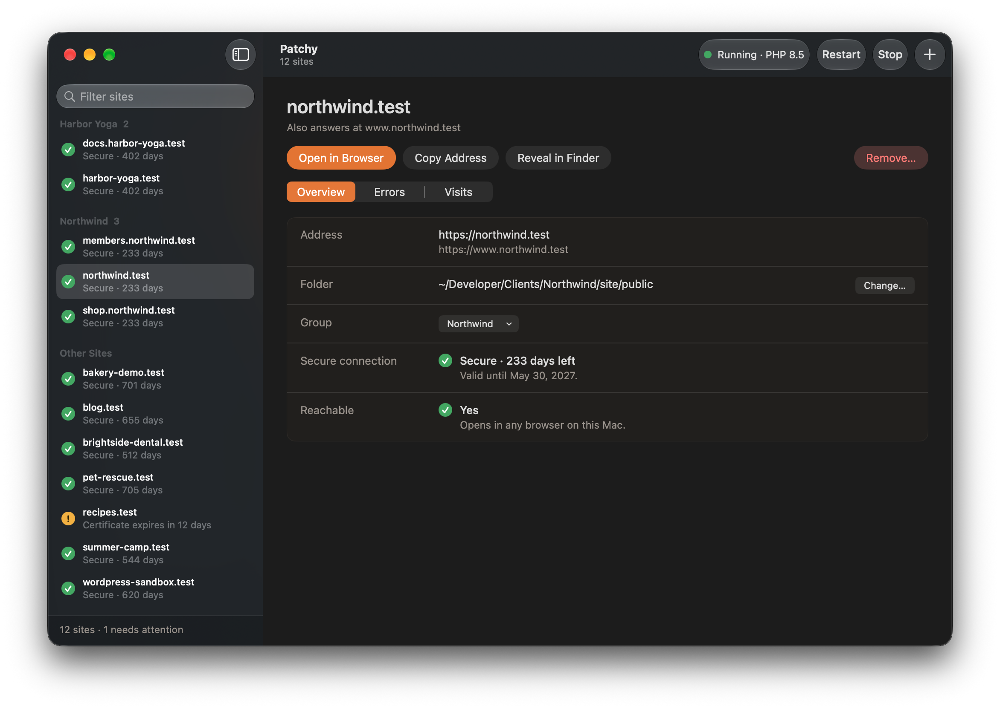
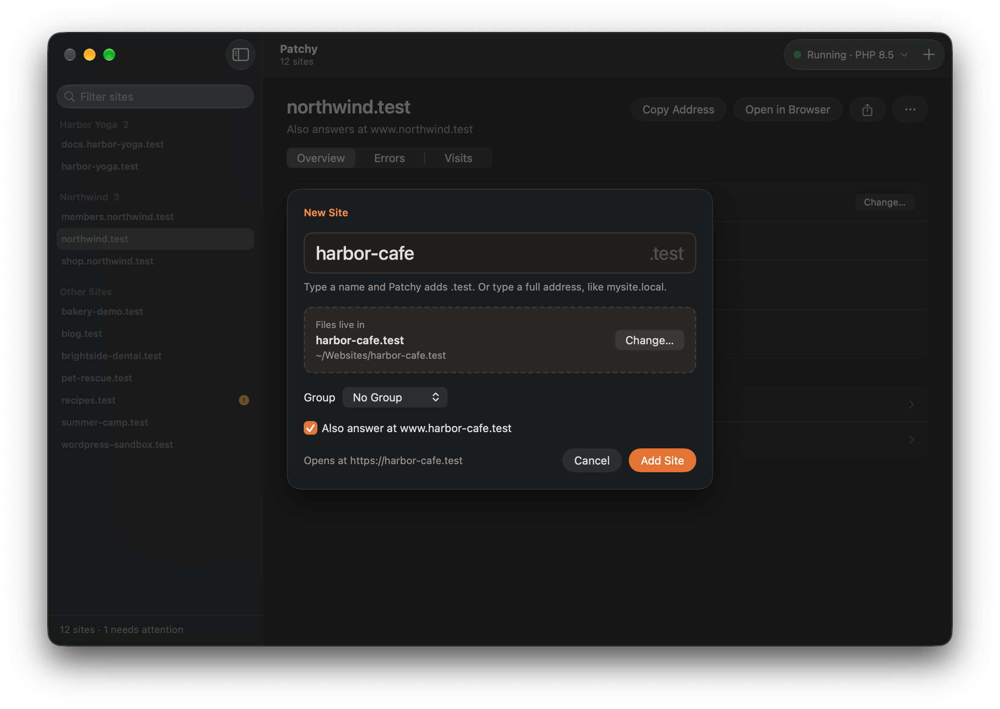

<div align="center">


# Patchy UI

**Host websites on your Mac without opening Terminal.**
A native macOS window and menu bar item for [Patchy](https://github.com/joeworkman/patchy).

[](https://github.com/jeso87/Patchy-UI/releases/latest/download/PatchyUI.dmg)
[](#requirements)
[](LICENSE)

<!-- GitHub honours prefers-color-scheme in <picture>, so the screenshot follows the reader's theme. -->
<picture>
  <source media="(prefers-color-scheme: dark)" srcset="docs/screenshots/main-window-dark.png">
  <source media="(prefers-color-scheme: light)" srcset="docs/screenshots/main-window-light.png">
  
</picture>

</div>

[Patchy](https://github.com/joeworkman/patchy) is Joe Workman's command-line
tool that turns a Mac into a local web server for PHP sites: Apache, mod_php,
local HTTPS and friendly `.test` addresses, one command per site. Patchy UI
puts all of that behind a window, for people who would rather click than type.

Patchy UI does not replace Patchy. Patchy does the real work and stays the
source of truth; this app reads what Patchy has set up and runs Patchy's own
commands for you. It is free, open source, and not affiliated with Joe Workman.

## What it does

- **See every site at a glance.** Each site shows its address, its folder,
  whether its secure connection is healthy, and whether it is reachable right
  now. Problems show up in the list without opening anything.
- **Add a site in two decisions:** what to call it, and which folder holds its
  files. Type `mysite` and you get `https://mysite.test`.
- **Change a site's folder** without removing and re-adding it. Nothing is
  moved or deleted.
- **Remove a site.** The address stops working; the folder stays where it is.
- **Share a site at a public link** so someone else can see it, for example a
  client reviewing a preview. One click gives a temporary link that works until
  you stop sharing. If you've set up your own domain with
  `patchy share setup`, Share asks each time: a stable address on your domain,
  with or without a password, or a temporary link.
  Sharing needs Cloudflare's free `cloudflared`; the app offers to install it.
- **Group related sites,** such as one customer's domain and subdomains. Groups
  show in the sidebar and as headings in the menu bar panel. The app suggests groups
  for sites that look related, and never groups anything by itself. Groups
  belong to Patchy UI only; Patchy itself is not changed.
- **Start, stop and restart the server** from the toolbar or the menu bar. If
  some addresses stop pointing at your Mac, one Repair button fixes them.
- **Read the logs.** Each site's errors and visits, live, with filtering,
  pause, and copy.
- **Switch PHP version** between the versions Homebrew has installed.
- **Refresh certificates** when they get close to expiring.
- **Set up password-free mode once,** so everyday changes stop asking for your
  Mac password. Or skip it, and the app asks for your password when a change
  needs it.
- **Menu bar panel** with the server's status, start/stop, and every site,
  problems first. Type part of a site's name and press Return to open it. Set a
  keyboard shortcut in Settings to open the panel from any app without touching
  the mouse. It keeps running when the window is closed.
- **In your language.** Patchy UI is available in 36 languages and follows
  the language set for it in System Settings › General › Language & Region.
  Patchy's own messages, shown under Show Details, stay in English. The
  translations are machine-made; corrections are welcome as pull requests to
  `translations/<lang>.json`.

  Arabic, Catalan, Chinese (Simplified), Chinese (Traditional, Hong Kong),
  Chinese (Traditional, Taiwan), Croatian, Czech, Danish, Dutch, English,
  Finnish, French, German, Greek, Hebrew, Hungarian, Icelandic, Italian,
  Japanese, Korean, Norwegian Bokmål, Norwegian Nynorsk, Persian, Polish,
  Portuguese (Brazil), Portuguese (Portugal), Romanian, Russian, Slovak,
  Slovenian, Spanish, Swedish, Thai, Turkish, Ukrainian and Vietnamese.

<div align="center">

</div>

Real web addresses are allowed (`mycompany.com`), with a clear warning first:
while the server runs, your Mac shows the local copy and cannot reach the live
site.

## Requirements

- macOS 14 or later
- [Homebrew](https://brew.sh)
- [Patchy](https://github.com/joeworkman/patchy), installed with Homebrew:

  ```bash
  brew install joeworkman/patchy/patchy
  ```

If Patchy is missing, Patchy UI says so and shows this command. It does not
install Homebrew or Patchy for you.

## Install

Download [PatchyUI.dmg](https://github.com/jeso87/Patchy-UI/releases/latest/download/PatchyUI.dmg),
open it, and drag Patchy UI to Applications. The app is signed and notarized.

## Version numbers follow Patchy

**Patchy UI's version is the Patchy release it was made for.** Patchy UI 1.2.1
supports Patchy 1.2.1.

Patchy UI works by running Patchy's commands and reading the files Patchy
writes, so it is only dependable when the two match. Each Patchy release gets a
matching Patchy UI release, built and tested against it.

- If the versions match, there is nothing to see.
- If Patchy is **newer** than the app, the app warns you and offers to check
  for an update. Most things will probably still work, but that Patchy release
  has not been tested with this app.
- If Patchy is **older** than the app, the app warns you and gives you the
  command to update Patchy (`brew upgrade joeworkman/patchy/patchy`).

A fix to Patchy UI alone, for the same Patchy release, adds a fourth number:
1.2.1.1 still means "made for Patchy 1.2.1".

The current versions are always in Patchy UI › About Patchy UI.

## Updates

Patchy UI checks for a new version once a day using
[Sparkle](https://sparkle-project.org), and you can check any time with
**Check for Updates…** in the Patchy UI menu or Settings › General. There is no setting to turn the daily check off,
because an out-of-date app is the thing most likely to cause problems after a
Patchy upgrade. Installing an update is never automatic: you are always shown
what changed and asked first.

Updates are downloaded from this repository's GitHub releases and verified
against a signing key built into the app before they are installed.

## What it does and doesn't do

**Network.** The daily update check, and the download if you accept an update,
are the only network requests Patchy UI makes on its own. When you share a
site, Patchy runs Cloudflare's `cloudflared`, and visitors to the link reach
your site through Cloudflare until you stop sharing or quit the app. It has no
analytics, no accounts and no telemetry.

**Your Mac password.** Some changes need administrator rights: setting up
password-free mode, creating the first certificate, and refreshing
certificates. Without password-free mode, so does every change that updates
your addresses: starting or stopping the server, and adding or removing a
site. When that happens the app asks for your Mac password in its own
window, checks it with macOS, and hands it to `sudo` for that one task. It is
never written to disk, never logged, and forgotten as soon as the task ends.

**Password-free mode** is Patchy's own `patchy trust`. It installs a small
root-owned helper that can do exactly one thing — update Patchy's lines in
`/etc/hosts` — and lets Patchy run it without a password. Patchy UI does not
add any privileged components of its own.

**Your files.** Patchy UI never moves or deletes a site's folder. Removing a
site removes its address, certificate and server configuration only.

**Changing a folder** is the one thing the app does that Patchy has no command
for. It edits that site's configuration file, asks Patchy to check the result,
and puts the file back exactly as it was if the check fails.

**Not sandboxed.** The app has to run Homebrew's tools and read files under
the Homebrew prefix, which the App Sandbox does not allow. That is also why it
is distributed here and not on the Mac App Store.

**Not included:** installing Homebrew, Patchy, PHP versions or PHP extensions
(the one exception is `cloudflared`, installed with Homebrew when you ask to
share a site);
editing `httpd.conf` or `php.ini`; turning password-free mode off (use
`patchy untrust`).

## Building from source

You need Xcode and [XcodeGen](https://github.com/yonaskolb/XcodeGen)
(`brew install xcodegen`).

```bash
git clone https://github.com/jeso87/Patchy-UI.git
cd Patchy-UI
xcodegen generate
open "Patchy UI.xcodeproj"
```

Or from the command line:

```bash
xcodebuild -project "Patchy UI.xcodeproj" -scheme "Patchy UI" -configuration Debug -derivedDataPath build build
open "build/Build/Products/Debug/Patchy UI.app"
```

To build under your own Apple developer account, change `DEVELOPMENT_TEAM` in
`project.yml` and regenerate. The Xcode project is generated from
`project.yml`; change settings there, not in Xcode.

### Tests

The logic lives in a Swift package, `PatchyKit`, with its own tests:

```bash
cd PatchyKit
swift test
```

These use a stand-in `patchy` script and never touch a real install. One
further test runs against the real Patchy on your Mac: it adds a throwaway
site, changes its folder and removes it, restarting Apache three times. It
only runs when asked for:

```bash
PATCHY_LIVE_TEST=1 swift test --filter LiveTests
```

### How it's put together

- **`PatchyKit/`** — everything that isn't UI. It reads Patchy's state
  straight from disk (site configuration files, certificates, `/etc/hosts`)
  and makes changes by running the `patchy` command on a pseudo-terminal, so it
  can answer Patchy's questions.
- **`PatchyUI/`** — the SwiftUI app: main window, menu bar item, settings.

`CLAUDE.md` has a fuller description for contributors, including the facts
about Patchy that shape the app.

## Releasing

For maintainers. `scripts/release.sh` tests, archives, signs with Developer ID,
notarizes, builds the DMG and regenerates the update feed (`appcast.xml`). It
publishes nothing; it ends by printing the GitHub steps that are left.

Before running it:

1. Upgrade Patchy to the release being supported, and test against it.
2. Set `MARKETING_VERSION` in `project.yml` to that Patchy version.
3. Raise `CURRENT_PROJECT_VERSION` in `project.yml`. Sparkle compares this
   number, not the version, so it must go up every time.
4. Write `docs/release-notes/<version>.md`. Sparkle shows it to every user.

The script refuses to continue if the Patchy installed on the build Mac is not
the version the release claims to support.

The update feed is served by GitHub Pages from `appcast.xml` on the default
branch, and each release's DMG is attached to its GitHub release.

## Credits

Patchy UI is made by [Joshua Omilian](https://joshuaomilian.ca).

Patchy is made by [Joe Workman](https://github.com/joeworkman). Patchy UI
would be nothing without it.

Updates are handled by [Sparkle](https://sparkle-project.org) (MIT license).

## License

MIT — see [LICENSE](LICENSE).
